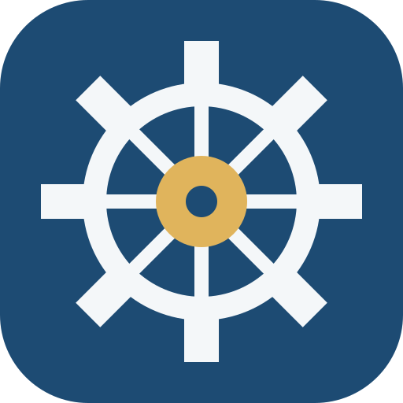

<p align="center">
  
</p>

<h1 align="center">Helmgear</h1>

<p align="center">
  <a href="https://github.com/Xer0bit/helmgear/actions/workflows/ci.yml"></a>
  <a href="LICENSE"></a>
  
</p>

Helmgear is an agent harness for business tasks. Your application hands it a request; it picks an agent template, runs that agent with only the tools the template allows, and holds every action that leaves the system until a person approves it.

It is experimental software. Read [SAFETY.md](SAFETY.md) before you run it.

## How a task runs

```
request ──> router (Jev) ──> template ──> agent (model loop, no shell, no file tools)
                                             │ tool calls over MCP
                                             ▼
                                          gateway ──> read / draft: runs now, audited
                                             └──────> send: queued until a person approves
```

- **Router.** A classifier scores the request against each template's description. If none fits, or the classifier fails, the answer is "no template". There is no default agent.
- **Agent.** The model loop runs as a separate process with a scrubbed environment. It has no shell and no file tools; its only tools are the ones the gateway lists for its template. Each run gets its own gateway token, and the gateway decides from that token which tenant and connectors the process is, so the process cannot claim otherwise.
- **Gateway.** A local MCP server that owns every connector. Each tool has a risk tier: `read` and `draft` run at once, `send` is written to a queue and runs only after approval. Every decision is appended to an audit log that stores payload hashes, not payloads. Tool results are cached under `results/` in the state folder so a retried call is not run twice; clear that folder on your own retention schedule.

## Run a task

Requires Node 24.9 or later and pnpm.

```sh
git clone https://github.com/Xer0bit/helmgear.git
cd helmgear
pnpm install
printf 'DEEPSEEK_API_KEY=...\nTYPESAFE_API_KEY=...\n' > .env   # git-ignored
```

```ts
import { createCore, firecrawlConnector, outboxConnector, startGateway } from '@helmgear/gateway'
import { jevClassifier } from '@helmgear/router'
import { createRunner } from '@helmgear/runner'

const stateDir = './state'
const connectors = [firecrawlConnector(), outboxConnector({ dir: `${stateDir}/outbox` })]
const core = createCore({ connectors, stateDir })
const gateway = await startGateway({ executor: core.executor, connectors })

const runner = createRunner({
  templatesDir: './templates',
  stateDir,
  gateway: { ...gateway, approvals: core.approvals },
  classifier: jevClassifier({ apiKey: process.env.TYPESAFE_API_KEY! }),
  model: { provider: 'deepseek-official', model: 'deepseek-flash' },
})

const result = await runner.runTask({ tenant: 'acme', request: 'Draft a post about our new invoice feature and send it to press@example.com' })
// { status: 'done', template: 'social-post', response: '...', pendingActionIds: ['...'] }
```

`runTask` returns one of: `done`, `failed` (the model turn ended in an error), `no-template`, or `refused`. It throws `RunnerError` if the agent process dies or stops answering.

## Named agents

The simplest way to use Helmgear: give an agent a name, pick its template once, and send it tasks. Nothing is routed per message.

```ts
import { AgentStore } from '@helmgear/runner'
const agents = new AgentStore(`${stateDir}/agents.json`)
agents.add('Maya', 'social-post', templateNames)          // the template is fixed for good
const maya = agents.get('Maya')!
await runner.runTask({ tenant: 'acme', template: maya.template, agentName: maya.name, request: '...' })
```

A named agent is told its name and its one job, and turns down work outside it in one line without calling a tool. To do a different job, create another agent. The router (`route`, `jevClassifier`) is still there for applications that want a request matched to a template automatically; `runTask` uses it only when no `template` is given.

### Jev as the agent's tool

`jevConnector({ apiKey })` from `@helmgear/router` gives an agent two fast judgement tools, each answered in well under a second:

| Tool | What it does |
|---|---|
| `jev.judge` | Up to 8 yes/no questions about one text, a probability for each, read as yes (0.7 and above), no (0.3 and below) or not settled |
| `jev.pick` | Which one of 2 to 12 described options a text belongs to, and whether any fits at all |

Jev judges; the agent decides what to do with the answer. The text goes to TypeSafe, so the two `sensitive` templates do not list `jev`. Jev also still checks each reply against the audit log (see Checked replies).

## Approvals

```ts
core.approvals.list('acme')                       // actions waiting, with their exact payload
await core.approvals.approve(actionId, 'sam')     // runs the stored payload once
core.approvals.reject(actionId, 'sam', 'wrong recipient')
core.audit.read()                                 // pending -> approved -> executed
```

A held action carries `untrustedSources`: the tools returning third-party content (a web page, a document) that the session had used before it asked. The list comes from the audit log, not from the agent. Show it to the approver, because a page can tell an agent to send something; no detector for that is reliable, so the person approving is the check.

An approval is refused if the stored payload, tool, tenant or session no longer matches what the audit log recorded when the agent asked for it, or if the audit log has no such request. `runTask` gives up after `timeoutMs` (default five minutes); actions already queued stay queued.

## Templates

A template is a folder in `templates/` holding one `SKILL.md`. Its frontmatter declares what the agent is:

```yaml
---
name: social-post                 # equals the folder name
description: Researches a topic and drafts a social media post.   # what the router sees
metadata:
  helmgear:
    persona: You are a social media manager ...   # the agent's system prompt
    connectors: [firecrawl, outbox]               # the only connectors it may use
    dataClass: public                             # or: sensitive
    reasoningEffort: off                          # off (default), low, high, max
---
```

A `sensitive` template refuses to run on the provider `deepseek-official`, because that API stores request data in mainland China. Run those templates against another host of the model:

```ts
createRunner({ /* ... */, model: {
  provider: 'my-host',                        // a name you choose
  model: 'the-model-id-that-host-uses',
  host: { baseURL: 'https://host.example/v1', apiKeyEnv: 'MODEL_HOST_API_KEY' },   // any OpenAI-compatible server
} })
```

The agent process receives that one key and no thinking level is requested from a hosted model. Naming DeepSeek's own API as the host does not lift the refusal. In the console and the evals, set `MODEL_HOST_URL`, `MODEL_HOST_MODEL` and `MODEL_HOST_API_KEY` in `.env`, then pick the model with `/model` or run `pnpm eval --host`.

Seven templates ship: `social-post`, `outreach-research`, `lead-finder`, `competitor-brief`, `knowledge-answer`, `email-triage` and `bookkeeping-proposal`.

## Connectors

| Connector | Tools | Notes |
|---|---|---|
| `firecrawl` | `search`, `scrape` (read) | Uses a self-hosted Firecrawl at `FIRECRAWL_URL` (default `http://127.0.0.1:3002`). Refuses LinkedIn, and any host that is or resolves to a local or private address. It does not follow redirects, so restrict the Firecrawl container's own network access as well. |
| `outbox` | `draft` (draft), `send` (send) | Writes JSON files. A stand-in for a real mail or publishing connector; nothing leaves the machine. |

A connector is an object with a name and a list of tools (`name`, `description`, `inputSchema`, `tier`, `run`). Pass your own to `createCore` and `startGateway`.

## The console

```sh
pnpm agent          # a terminal console: type a task, watch the agent work
pnpm firecrawl:up   # start the self-hosted Firecrawl containers if web tools fail
```

Create an agent with `/agent new <name> <template>`, switch with `/agent <name>`, and type a task. The console shows each tool call as the gateway records it, the reply, and whether the reply matches that record. Each agent keeps its own conversation. `/help` lists its commands; `/status` shows which connectors are on.

## Plan first

```ts
const planned = await runner.runTask({ tenant, request, mode: 'plan' })
// { status: 'plan', plan: '...', sessionId, template }   nothing was done: the agent held no tools
const result = await runner.runTask({ tenant, template: planned.template, request: 'Approved. Carry out the plan now.', continue: { sessionId: planned.sessionId } })
```

`continue` resumes a session, so a follow-up message or an approved plan runs with everything said so far. The console does this for you when `/plan` is on.

## Real connectors

| Connector | Turn it on | Tools |
|---|---|---|
| `email` | `SMTP_HOST`, `SMTP_FROM` (and `SMTP_PORT`, `SMTP_USER`, `SMTP_PASS`) in `.env` | `email.send`: one plain-text email to one recipient |
| `x` | `X_ACCESS_TOKEN` in `.env` | `x.post`: one post, at most 280 characters |
| any MCP server | an entry in `connectors.json` (copy `connectors.example.json`) | every tool that server offers |

Every tool of these is held for approval, except MCP tools you mark `read` or `draft` in `connectors.json`. `mcpConnector` holds a tool by default because the gateway cannot know what a third-party tool does. A template uses a connector by naming it in `connectors`; a name with no connector behind it simply adds no tools. See `.env.example` for every setting.

Each template also has a tool budget (`maxToolCalls`, default 12). The gateway counts the calls and refuses the rest, so a research task cannot run away. It also stops a loop: the same call with the same input is answered from the first result the second time and refused the third time.

## Knowledge base

Each tenant has its own knowledge base: the documents its agents may consult about the business.

```ts
import { KnowledgeBase, knowledgeConnector, teiEmbedder } from '@helmgear/knowledge'
const kb = new KnowledgeBase({ dir: `${stateDir}/kb` })                       // keyword search
// const kb = new KnowledgeBase({ dir, embedder: teiEmbedder({ url }) })      // plus embedding search
await kb.add('acme', { title: 'Refund policy', source: 'refunds.md', text })  // same source again replaces it
const connectors = [/* ... */, knowledgeConnector({ kb })]
```

- **A person decides what goes in.** Agents get `kb.search` and `kb.read`, both read-only. There is no tool that adds or edits a document, which is the defence against planted documents; no detector for those is reliable.
- **Passages follow the document's own structure**: whole paragraphs grouped under their heading, indexed together with the document title and heading path.
- **Search** is BM25 keyword search. Set `HELMGEAR_EMBEDDINGS_URL` to a text-embeddings-inference server and embedding similarity is fused in, which is what finds a passage worded differently from the question.
- **Reranking** is optional: pass `reranker: teiReranker({ url })` (console: `HELMGEAR_RERANKER_URL`) and a reranking model reads the top 20 candidates against the question and sets the final order. If that server is down, the first-pass order is used.
- **Files**: `extractText(file)` reads `.md`, `.txt`, `.csv`, `.json`, `.html`, `.pdf` (needs `pdftotext` from poppler-utils) and `.docx` (needs `unzip`). A scanned PDF has no text layer and is refused as empty.
- **Answers cite** the document and section. The `knowledge-answer` template answers only from the knowledge base and says so when it is silent; every other template lists `kb` and is told to check it before stating facts about the business.
- In the console: `/kb add <file or URL> [title]`, `/kb list`, `/kb remove <n>`, `/kb search <question>`. A file can be text, HTML, PDF or Word; a URL is read through Firecrawl.

`pnpm eval --only kb` measures retrieval on a labelled question set, graded by code.

## Checked replies

An agent can say it did something it did not do. Give the runner a judge and it compares each reply with the audit log:

```ts
import { jevJudge } from '@helmgear/router'
const runner = createRunner({ /* ... */, judge: jevJudge({ apiKey: process.env.TYPESAFE_API_KEY! }) })
const result = await runner.runTask({ tenant: 'acme', request: '...' })
// result.actions   what the gateway recorded for this run: trust this
// result.verified  true only when the reply claims nothing the record does not support
// result.problems  what did not match
// result.report    the actions in plain lines by outcome, written from the record:
//                  "Done: firecrawl.research ×2\nWaiting for your approval: email.send"
```

When they disagree, the agent gets one turn to fix the reply or make the missing tool call. Without a judge, `verified` is `false`.

## Memory and lessons

```ts
import { memoryConnector, MemoryStore } from '@helmgear/gateway'
const memory = new MemoryStore(`${stateDir}/memory`)
const connectors = [/* ... */, memoryConnector({ store: memory })]
const core = createCore({ connectors, stateDir, memory })
const runner = createRunner({ /* ... */, memory })

memory.add('acme', { kind: 'fact', text: 'Our product is called Tidewater.', source: 'person' })
```

- **Facts.** A template that lists `memory` in its connectors can propose a fact with `memory.propose`. The proposal waits in the approval queue like a send, so text an agent read on a web page cannot become memory unless you approve it.
- **Lessons.** When you reject an action with a reason, the reason is stored for that tenant and template, and later runs see it.
- Both are added to the agent's instructions, newest first, up to 2,000 characters. Lessons get at most 30% of that, so a run of rejections cannot push the facts out.
- **Expiry.** An entry with `expiresAt` stops being shown after that moment. A lesson expires after 90 days; a fact never does unless you set a date. `memory.update(tenant, id, text)` corrects one entry in place.

## Many tasks, and scheduled tasks

```ts
import { runBatch } from '@helmgear/runner'
const results = await runBatch(runner, items, { concurrency: 4 })   // input order; a failure does not stop the rest

import { Scheduler } from '@helmgear/scheduler'
const scheduler = new Scheduler({ file: `${stateDir}/jobs.json`, run: job => runner.runTask(job) })
scheduler.add({ tenant: 'acme', template: 'competitor-brief', request: '...', when: { dailyAt: '08:00' } })
setInterval(() => scheduler.tick(), 30_000)
```

A job runs at most once per slot: each `everyMinutes` period, or each UTC day after `dailyAt`. The slot is recorded before the job starts, so a restart does not run it twice. Your application owns the timer; run one scheduler per file. A send from a scheduled run still waits for approval.

## Evaluate

```sh
pnpm eval                  # routing accuracy and agent cases against a fictional company
pnpm eval --trials 5 --gate   # fail if results are worse than evals/baseline.json
```

See `evals/README.md` for the cases and the latest numbers.

## Develop

```sh
pnpm typecheck     # tsc -b
pnpm test          # unit tests
pnpm test:e2e      # live tests; each skips itself when its key is missing
```

The control plane lives in `packages/control/` (`template`, `gateway`, `router`, `runner`, `scheduler`, `knowledge`). The model loop underneath is the `agent` profile in `packages/bundle/agent/`.

## Contributing

See [CONTRIBUTING.md](CONTRIBUTING.md). Report vulnerabilities privately as described in [SECURITY.md](SECURITY.md). Release history is in [CHANGELOG.md](CHANGELOG.md).

## Licence

[MIT](LICENSE). Helmgear is the original copyright notice is kept in `LICENSE`. Third-party dependencies and their licences are listed in [THIRD_PARTY_NOTICES.md](THIRD_PARTY_NOTICES.md).
